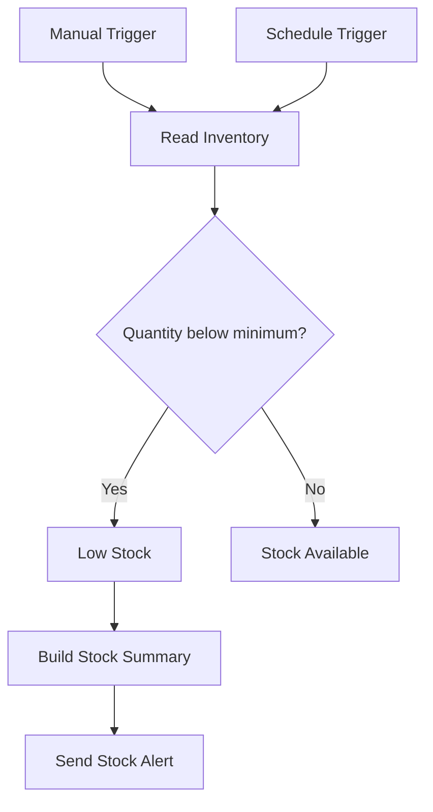

# Stock Alert — n8n, Google Sheets & Outlook

A rule-based inventory monitoring workflow that reads stock from Google Sheets and sends one Outlook email summarizing products below their minimum stock level.

Built as a learning and portfolio project. No AI model or paid AI API is required. Hosting and connected services may have their own limits or costs.

## Workflow



## Features

- Read six sample products, or a larger inventory, from a spreadsheet.
- Compare numeric quantity and minimum fields for each row.
- Calculate units needed to reach the minimum.
- Send a single consolidated email for low-stock products.
- End without an email when every product has sufficient stock.
- Support manual tests and a daily 09:00 schedule in Europe/Dublin.

## Repository files

- `workflows/stock-alert.json`: sanitized n8n workflow, inactive on import.
- `examples/inventory.csv`: sample inventory with three low-stock products.
- `examples/alert-example.txt`: expected email for the sample inventory.

## Setup

1. Import `workflows/stock-alert.json` into a compatible n8n instance.
2. Import `examples/inventory.csv` into Google Sheets. Name the worksheet tab `Inventory`.
3. Keep the headers exactly `product`, `quantity`, and `minimum`. Store quantity and minimum as numbers.
4. Open **Read Inventory**, connect your Google Sheets OAuth2 credential, and select your document and worksheet. Replace `YOUR_GOOGLE_SHEET_ID` with your document ID, or switch to the document picker.
5. Open **Send Stock Alert**, connect your Microsoft Outlook OAuth2 credential, and replace `recipient@example.com` with your test recipient. Review the recipient before executing.
6. The email subject and message use `{{ $json.subject }}` and `{{ $json.message }}`. Use plain text for the body.
7. Run from **Manual Trigger**. With the sample CSV, expect three low-stock products and seven units required in total.
8. Confirm the workflow timezone is **Europe/Dublin** and the Schedule Trigger is every day at **09:00**.
9. Publish/activate only after credentials, document, recipient, and schedule are configured. The n8n instance must remain running for scheduled executions.

The public template contains no account credentials, personal recipient address, original spreadsheet links, pinned data, or original instance metadata. Configure your own connections after importing. The original working workflow is unchanged.

## Stock rule

```javascript
quantity < minimum
restock_quantity = minimum - quantity
```

Equality counts as sufficient stock. Replenishment brings stock to the minimum; it does not calculate an optimal purchase quantity or place orders.

## Validation performed during the guided build

| Scenario | Expected result | Observed during build |
|---|---|---|
| Original sample: Shampoo 3, Hair Mask 2, Heat Protectant 1 | Three products, seven units, one email | Confirmed |
| Change Shampoo quantity to 5 | Two products, five units, one email | Confirmed |
| All quantities at or above minimum | Six items on Stock Available, no email branch | Confirmed route to Stock Available |

These were manual checks of the original configured workflow. The sanitized template requires setup and a fresh test in the importing environment. A future scheduled execution was not observed during packaging.

## Limitations and troubleshooting

- This is a learning prototype, not a production inventory system.
- Every scheduled run sends another summary if stock remains low; alert deduplication is not implemented.
- Inventory changes only when someone updates the spreadsheet. This workflow does not track sales or purchases.
- Input validation, retry policies, and a separate failure notification workflow are not implemented.
- Empty sheets produce no inventory items and therefore no stock alert.
- Wrong numeric types: check spreadsheet cells are numeric and contain no extra text.
- Old values: check the selected document/tab, remove pinned test data, and run the complete workflow.
- No email with sufficient stock is expected. For a low-stock case, check execution history and the Outlook credential.
- Imported nodes may need updates if your n8n version does not support the exported node versions.

## Suggested next improvements

Validate input rows, log daily checks, add failure notifications, and prevent repeated alerts until stock changes.
